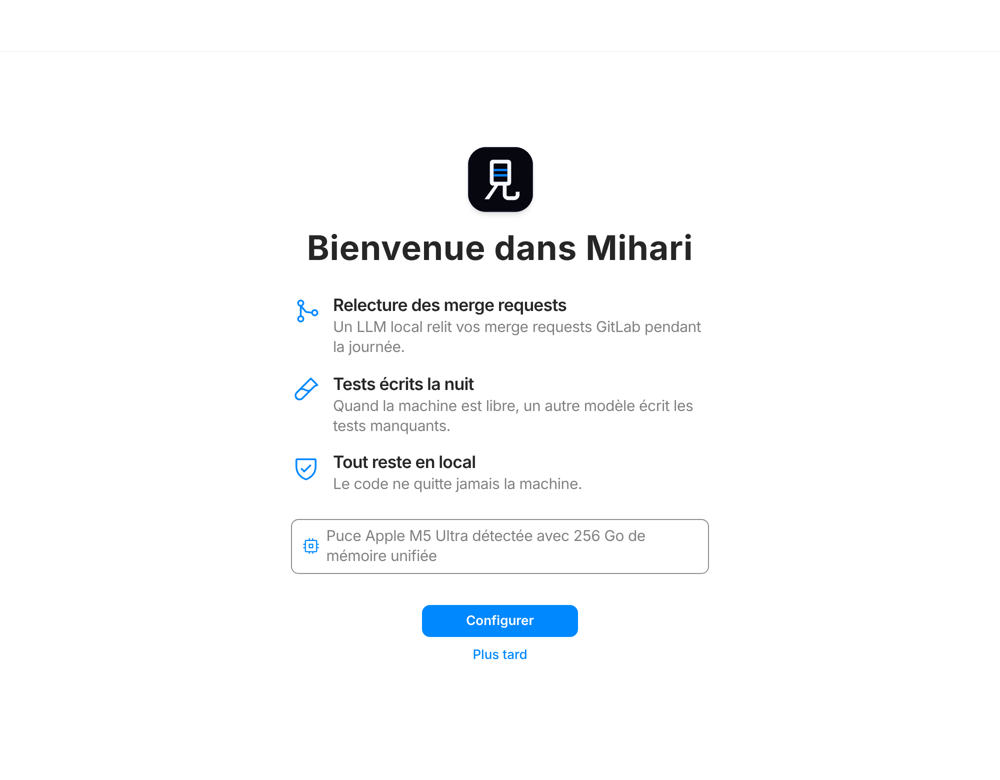
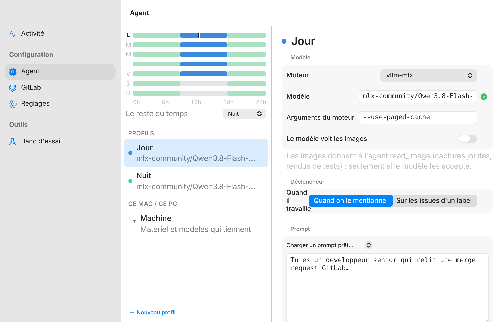
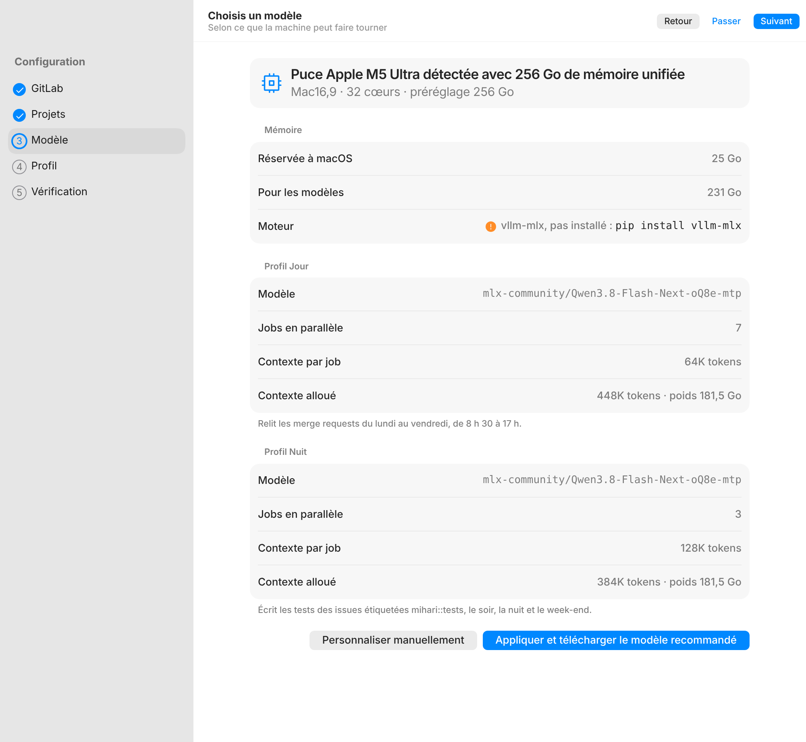
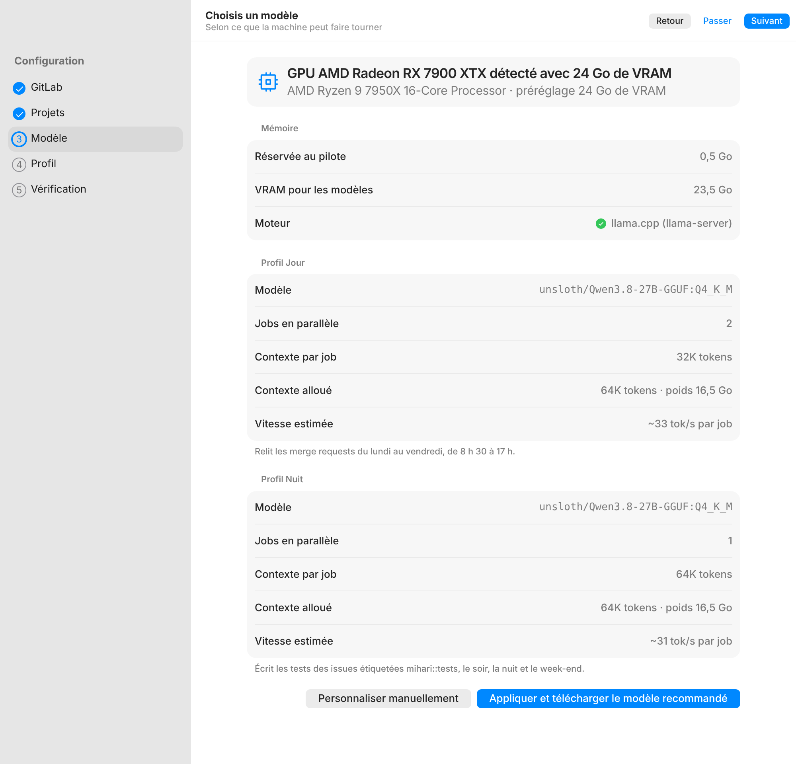

# Mihari

Mihari (見張り, « sentinelle » en japonais) est une application de bureau qui fait tourner des LLM en local pour relire les merge requests GitLab et écrire des tests. Elle relit le code le jour et rédige des tests la nuit, sans que le code ne quitte la machine.

> Projet en cours de développement (V1). La supervision centralisée n'est pas encore implémentée.

## Aperçu

| Accueil | Agent : profils et semaine |
|---|---|
|  |  |

| Préréglage sur Mac Apple Silicon | Préréglage sur PC |
|---|---|
|  |  |

## Fonctionnalités

### V1

- Configuration des profils de modèles : un modèle de journée et un modèle de nuit, avec le nombre de jobs en parallèle pour chacun
- Planning : plages horaires et profil actif sur chaque plage
- Connexion à une instance GitLab : URL, compte bot, token stocké dans le trousseau du système
- Détection des merge requests à relire par interrogation de l'API GitLab, sans webhook
- Review automatique des merge requests et publication des commentaires
- Écran d'état : modèle chargé, jobs en cours et en attente

### Prévu

- Écriture de tests unitaires et e2e la nuit, dans un conteneur basé sur l'image CI du projet
- Supervision centralisée de plusieurs machines (bail signé, configuration imposée, tableau de bord)
- Détection des usages hors périmètre
- Paquets d'installation signés pour macOS, Linux et Windows

## Architecture

```
┌──────────────────────────────┐
│ Interface (Svelte + TS)      │
└──────────────┬───────────────┘
               │ bindings Wails
┌──────────────▼───────────────┐
│ Cœur (Go)                    │
│  - configuration             │
│  - planificateur jour/nuit   │
│  - polling GitLab            │
│  - file de jobs (SQLite)     │
│  - moteurs d'inférence       │
└───────┬──────────────┬───────┘
        │              │ API compatible OpenAI
        │      ┌───────▼────────────────┐
        │      │ vllm-mlx (macOS)       │
        │      │ llama.cpp (Linux/Win)  │
        │      └────────────────────────┘
        │ API REST (sortant uniquement)
┌───────▼──────────────────────┐
│ GitLab                       │
└──────────────────────────────┘
```

Principes :

- Le cœur ne parle jamais directement à un runtime : chaque moteur d'inférence implémente la même interface (démarrer un modèle avec N slots, arrêter, vérifier l'état, exposer l'URL de l'API).
- Un seul modèle chargé par profil, avec plusieurs slots pour traiter les reviews en parallèle.
- Toutes les connexions partent de la machine : aucun port n'est ouvert.
- Le serveur d'inférence n'écoute que sur `127.0.0.1`.

## Stack

| Partie | Technologie |
|---|---|
| Application de bureau | [Wails v3](https://v3alpha.wails.io/) (bêta) |
| Interface | Svelte + TypeScript + Vite |
| Cœur | Go |
| Stockage | SQLite (`modernc.org/sqlite`, sans CGO) |
| Secrets | Trousseau du système (`zalando/go-keyring`) |
| Inférence macOS | MLX via vllm-mlx |
| Inférence Linux et Windows | llama.cpp |

## Prérequis

- Go 1.25 ou plus récent
- Node.js et npm
- CLI Wails v3 :

```
go install github.com/wailsapp/wails/v3/cmd/wails3@latest
```

Selon le système :

- **Arch Linux** : `gtk4` et `webkitgtk-6.0`
- **macOS** : Xcode Command Line Tools
- **Windows** : WebView2 (inclus dans Windows 11)

Vérifier l'environnement :

```
wails3 doctor
```

## Développement

Lancer l'application en mode développement, avec rechargement à chaud :

```
wails3 dev
```

Compiler un binaire de production :

```
wails3 build
```

Le binaire est généré dans `bin/`.

### Tester sans le GitLab de production

Le plus simple : un compte bot sur gitlab.com, et la section **Projets de test GitLab** de la page Dev.

1. Créer un compte gitlab.com pour le bot et un token d'accès personnel avec le scope `api`, puis connecter Mihari à `https://gitlab.com` avec ce compte.
2. Dans la page Dev, **Créer les projets de test** : des projets privés `mihari-test-*` sur le compte du bot, avec du code Go et TypeScript, des MR qui contiennent des bugs à trouver (et une qui n'en a pas) et des issues étiquetées `mihari::tests` pour le profil de nuit. Ils sont allumés dans Mihari dès leur création.
3. **Demander une review** sur une MR crée la tâche qu'un ping créerait. Pour pinguer le bot pour de vrai, renseigner son propre pseudo dans **Inviter** avant la création : il est ajouté aux projets comme développeur.
4. **Réinitialiser** supprime les projets et les refait à neuf ; **Supprimer** les retire. Seuls les projets `mihari-test-` du compte du bot sont touchés.

Les données de départ sont dans `internal/devlab/_fixtures`, un dossier par projet.

Ou lancer une instance GitLab CE locale avec Docker, puis y créer un projet de test et un compte bot :

```
docker run -d --name gitlab -p 8929:80 -v gitlab-data:/var/opt/gitlab gitlab/gitlab-ce:latest
```

Prévoir environ 4 Go de RAM pour l'instance.

### Tester sans gros GPU

Utiliser un petit modèle GGUF avec llama.cpp dans un profil de développement. Le moteur vllm-mlx ne se teste que sur un Mac Apple Silicon.

Ou déporter l'inférence avec le moteur **OpenCode (dev, distant)**, présent seulement dans les builds de développement :

1. Créer une clé API sur [opencode.ai/auth](https://opencode.ai/auth), avec un abonnement OpenCode Go ou des crédits Zen.
2. Dans la page Dev, choisir l'offre (Go, Zen, ou une autre API compatible OpenAI), renseigner la clé (gardée dans le trousseau), puis **Tester** et **Enregistrer**.
3. Dans un profil, choisir ce moteur et un modèle servi en `/v1/chat/completions` (`glm-5.3`, `kimi-k3`, `deepseek-v4-pro`…). Les modèles gratuits de Zen sont réservés au client OpenCode et refusent les autres applications ; Zen sans crédit répond `402`.

Mihari sert l'API sur `127.0.0.1` derrière un proxy qui ajoute la clé, son user agent et l'identifiant de session par job qu'OpenCode Go exige : les jobs y parlent comme à un moteur local. Le code des MR part alors chez le fournisseur, d'où le moteur absent des builds de production.

## Configuration

Exemple de configuration :

```yaml
profiles:
  jour:
    backend: vllm-mlx
    model: mlx-community/Qwen3.8-Flash-Next-4bit
    parallel: 7
    context_per_slot: 65536
  nuit:
    backend: vllm-mlx
    model: Vontra/MiMo-V2.6-Flash-RL-MLX-4bit-MTP
    parallel: 3
    context_per_slot: 131072
schedule:
  - days: [mon, tue, wed, thu, fri]
    from: "08:30"
    to: "17:00"
    profile: jour
  - days: [mon, tue, wed, thu, fri, sat, sun]
    from: "17:00"
    to: "08:30"
    profile: nuit
gitlab:
  url: https://gitlab.example.com
  bot_username: review-bot
  poll_interval: 30s
```

Le token GitLab n'est jamais écrit dans ce fichier : il est stocké dans le trousseau du système.

### Préréglages Apple Silicon

Au premier lancement sur un Mac Apple Silicon, l'étape Modèle lit la puce (`machdep.cpu.brand_string`), l'identifiant (`hw.model`) et la mémoire unifiée (`hw.memsize`), puis propose un profil Jour et un profil Nuit sur `vllm-mlx`. macOS garde un cinquième de la mémoire, entre 15 et 25 Go.

| Mémoire | Modèle | Jour | Nuit |
|---|---|---|---|
| 36 à 48 Go | `Qwen2.5-Coder-14B-Instruct-8bit` le jour, `Qwen2.5-Coder-32B-Instruct-4bit` la nuit | 2 jobs × 32K | 1 job × 64K |
| 64 à 96 Go | `Qwen3-Coder-30B-A3B-Instruct-8bit` | 4 jobs × 48K | 2 jobs × 96K |
| 128 Go | `Qwen3-Coder-Next-8bit` | 5 jobs × 64K | 2 jobs × 128K |
| 192 à 256 Go | `DeepSeek-V4-Flash-8bit` | 7 jobs × 64K | 3 jobs × 128K |
| 512 Go | `deepseek-ai-DeepSeek-V4-Flash-8bit` | 8 jobs × 64K | 4 jobs × 128K |

Le profil Jour relit les MR en semaine de 8 h 30 à 17 h ; le profil Nuit écrit les tests des issues étiquetées `mihari::tests` le reste du temps.

### Préréglages PC

Sur Linux et Windows, le préréglage est calculé à partir des GPU détectés : NVIDIA par `nvidia-smi`, AMD Radeon et Intel Arc (séries A et B) par leur identifiant PCI (`/sys/class/drm` sous Linux, pilotes du registre sous Windows). Pour chaque profil, Mihari retient le meilleur modèle du catalogue qui tient entièrement en VRAM, sans jamais déborder en RAM, à au moins 20 tok/s par job le jour et 10 la nuit, avec les tailles réelles lues sur Hugging Face. La nuit garde 128K de contexte, ou descend à 64K si ça permet un meilleur modèle.

Sans GPU, avec une carte absente des tables (débit mémoire inconnu), sous 36 Go sur Mac ou via « Personnaliser manuellement », l'étape reprend le conseiller générique.

## Fonctionnement côté GitLab

1. Créer un compte bot sur l'instance GitLab et lui donner accès aux projets à relire.
2. Générer un token d'accès pour ce compte et le saisir dans Mihari.
3. Pour demander une review, ajouter le compte bot comme reviewer de la merge request.
4. Mihari détecte la demande au passage suivant du polling, relit le diff et publie ses commentaires.

Chaque merge request n'est relue qu'une fois par commit (clé : projet, IID, SHA).

## Structure du projet

```
.
├── build/           fichiers de packaging par plateforme
├── docs/            captures d'écran du README
├── frontend/        interface Svelte
├── main.go          point d'entrée de l'application
├── Taskfile.yml     tâches de build Wails
└── go.mod
```

## Licence

À définir.
